

  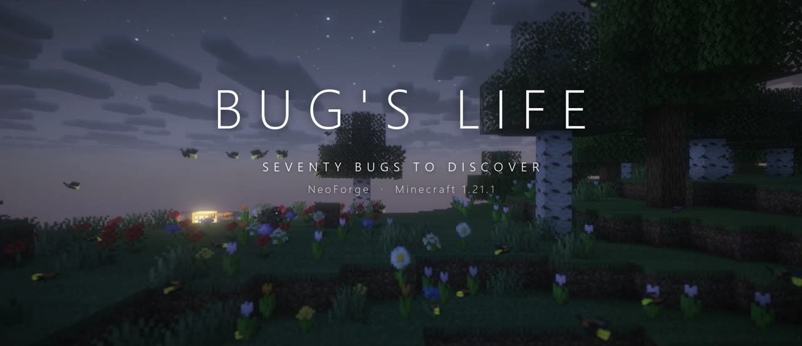

  <b>Seventy bugs to find, catch, keep, breed, harvest and (if you're brave) eat.</b> 
  A NeoForge mod for Minecraft 1.21.1 by Cosmic Monster Studios.

  
  
  
  

---

Bug's Life fills the world underfoot. Every bug lives in its own habitat, from ladybugs on farmland and fireflies over
night-time meadows to glowworms on cave ceilings, ember beetles in the Nether and void moths in the End. Catch them with
a net, keep them in terrariums, breed them, harvest what they make, and fill in the Field Guide as you go.

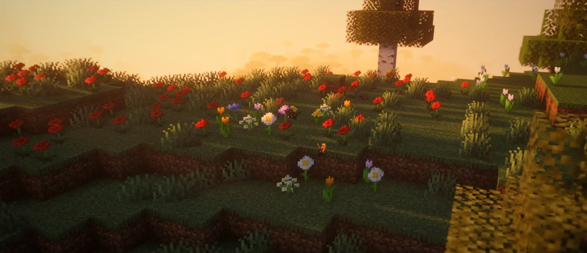

## Highlights

- **70 bugs** across every dimension, each with its own habitat, rarity, food and harvest, and most with a behaviour of
  their own: ladybugs hunt aphids, orb weavers spin real cobwebs, pill bugs roll up, walking sticks freeze when you look
  at them, storm beetles call down lightning.
- **Animated 3D models** for every bug (GeckoLib), with glowing layers for fireflies, glowworms, morphos and more.
- **Bug Net and Bug Jars** to catch them; sneaking and timing help with the rare ones.
- **Terrariums** that hold bugs, produce their harvest over time, breed matching pairs and light up with glowing bugs.
- **Field Guide** with a live 3D model of every bug you've caught and habitat hints for the ones you haven't.
- **Chitin gear**: 3D scale armour that makes you bug-proof, a shield that throws hits back, and seamless decor blocks.
- **Prismatic bugs**: a 1 in 400 chance for any wild bug to shimmer through the rainbow.
- **Bug food**, from Roasted Grubs to Cricket Cookies, and **43 advancements**.

## Gallery

<table>
<tr><td width="33%">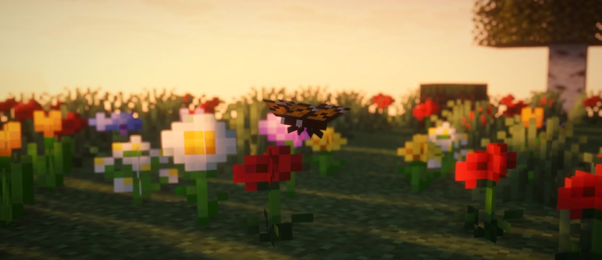 Monarch over a flower bed at dawn</td><td width="33%">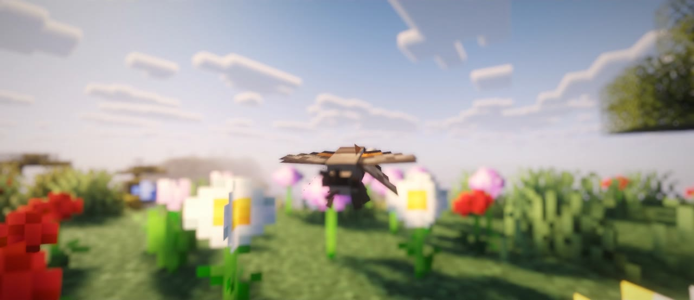 Hummingbird hawk-moth</td><td width="33%">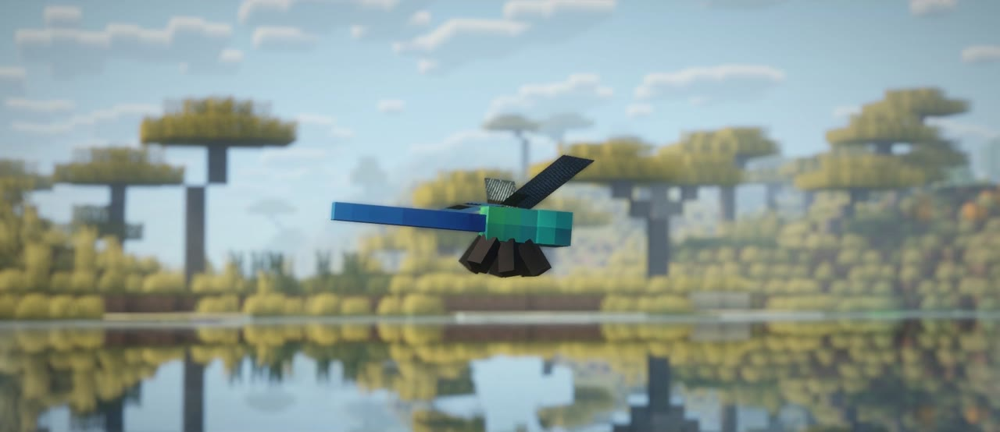 Dragonfly over a savanna river</td></tr>
<tr><td width="33%">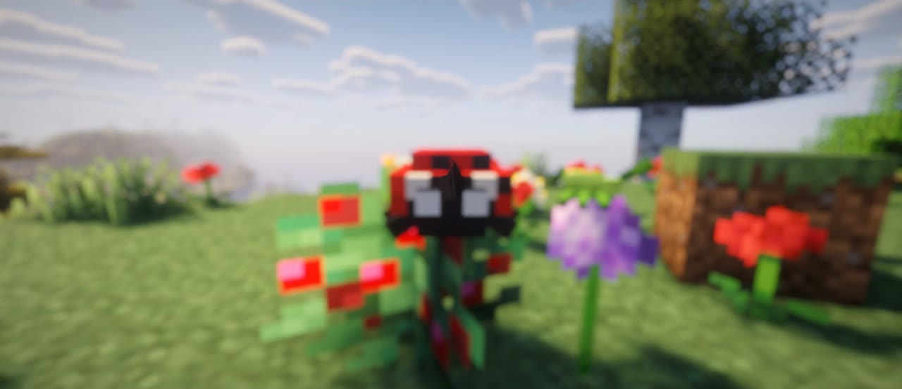 Ladybug hunting aphids</td><td width="33%">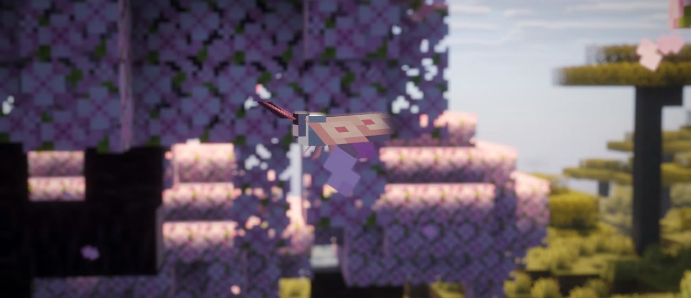 Sakura moth in a cherry grove</td><td width="33%">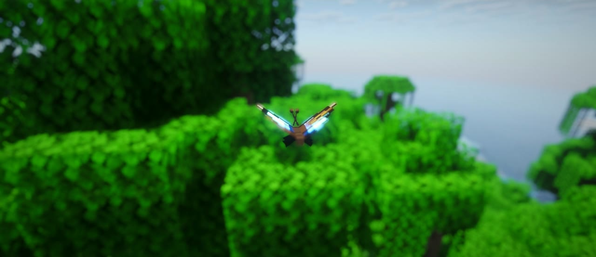 Blue morpho over the jungle</td></tr>
<tr><td width="33%">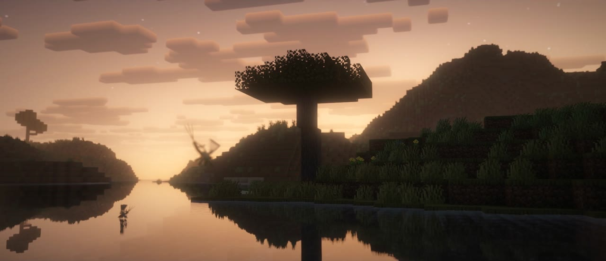 Mayflies at sunset</td><td width="33%">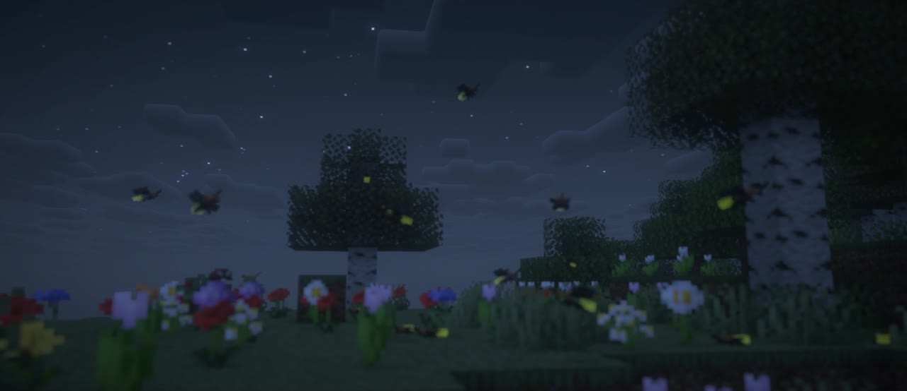 Fireflies over the meadow</td><td width="33%">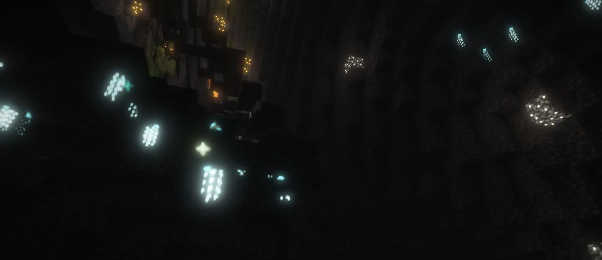 Glowworms on a cave ceiling</td></tr>
<tr><td width="33%">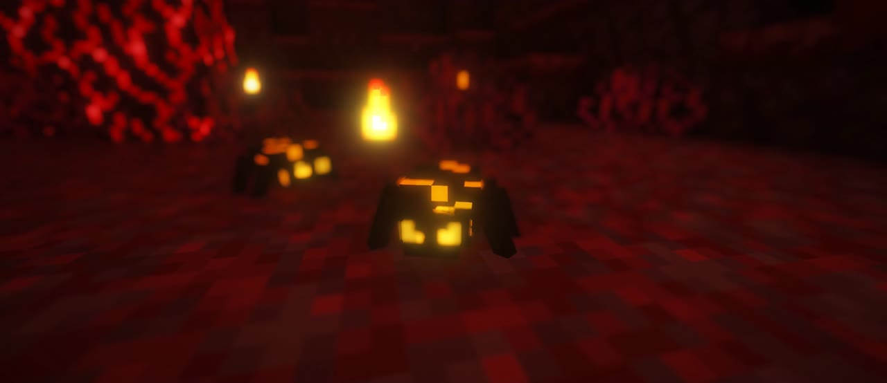 Ember beetles in a crimson forest</td><td width="33%">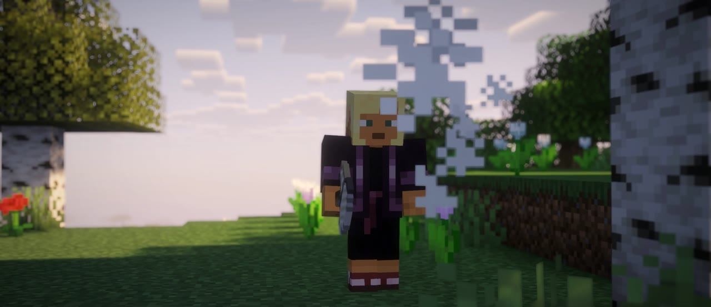 Catching a monarch with the Bug Net</td><td width="33%">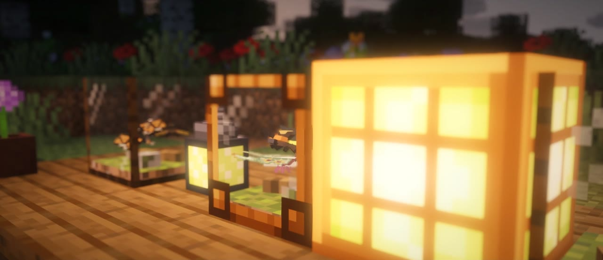 Terrariums and a Firefly Lantern</td></tr>
</table>

Screenshots taken with the Complementary Reimagined shader pack through Iris. The mod itself needs no shaders.

## Installation

1. Install [NeoForge](https://neoforged.net/) 21.1.x for Minecraft 1.21.1.
2. Drop the Bug's Life jar into your `mods` folder.

[GeckoLib](https://modrinth.com/mod/geckolib) 4.9.3 is bundled inside the jar, so nothing else is needed. The mod is
required on both the client and the server.

## Getting started

Craft a **Bug Net** (string and sticks) and a few **Bug Jars** (glass and planks). Use the net on a bug while you carry
an empty jar and, if it doesn't slip away, it's yours. Craft a **Field Guide** (book and string) to see what lives where,
then build a **Terrarium** to start a collection. The full guide is [below](#playing).

## The bugs

### The original twenty

| Bug | Rarity | Where to look | Harvest | Favourite food |
| --- | --- | --- | --- | --- |
| Ladybug | Common | Crops and farmland by day; climbs tree trunks | Frass | Sweet berries |
| Aphid | Common | On crops and the tops of leaves | Honeydew | Wheat |
| Firefly | Common | Over grass on warm nights, near water | Glow Goo | Sugar |
| Cricket | Common | Around villages at night | Frass | Wheat seeds |
| Pill Bug | Common | Moss, podzol, mud, shaded forest floor, shallow caves | Frass | Brown mushroom |
| Water Strider | Common | Skating on fresh water by day | Frass | Crunchy grub |
| Monarch Butterfly | Uncommon | Around flowers by day | Honeydew | Any small flower |
| Silk Moth | Uncommon | Birch and dark oak leaves after dark | Silk | Leaves |
| Dragonfly | Uncommon | Over rivers, lakes and swamps | Chitin | Crunchy grub |
| Dung Beetle | Uncommon | Wherever livestock graze | Frass x2 | Frass |
| Cave Weta | Uncommon | Pitch-dark stone caves | Chitin | Red mushroom |
| Walking Stick | Rare | Hidden in tree canopies | Sticks | Leaves |
| Jewel Beetle | Rare | Only on birch trunks, by day | Chitin (+ rare emerald) | Honeydew |
| Stag Beetle | Rare | Oak and dark oak trunks at night | Chitin | Apple |
| Glowworm | Rare | Hanging from cave ceilings (lush/dripstone caves) | Glow Goo (+ silk) | Glow berries |
| Hercules Beetle | Epic | Jungle trunks at night | Chitin x2 | Melon slice |
| Ember Beetle | Epic | Netherrack, basalt and nylium in the Nether | Blaze powder | Nether wart |
| Sculk Mite | Epic | On sculk in the Deep Dark | Bottle o' Enchanting | Amethyst shard |
| Golden Scarab | Legendary | Desert sand at night | Gold nuggets | Golden carrot |
| Void Moth | Legendary | Chorus plants and end rods in the End | Ender pearl | Chorus fruit |

### The expansion: fifty more

Every one of these has its own trick.

| Bug | Rarity | Where to look | What makes it special |
| --- | --- | --- | --- |
| Worker Ant | Common | Open dirt and grass by day, marching in columns. | Marches in follow-the-leader columns and tends aphids. |
| Earwig | Common | Dark nooks at night: under the forest canopy and around villages. | Hates light: scuttles to the darkest nearby spot. 'pinch' snaps the forceps. |
| Termite | Common | Savannas, and anywhere near fallen logs. | Eats dropped wooden items (sticks, saplings, planks, logs) and turns them into frass. |
| Millipede | Common | Damp woodland floors after dark. | Curls up when threatened; poisons anyone who hits it bare-handed. |
| Caddisfly Larva | Common | On the beds of rivers and streams. | Lives underwater on stream beds. |
| Mosquito | Common | Over swamps and still water at night. | Bites players at night, then flies off full. |
| Mayfly | Common | Dancing over rivers at dusk. | Lives only a few minutes before vanishing. |
| Grasshopper | Common | Sunny plains, savannas and meadows. | Leaps away in huge bounds when you come near. |
| Springtail | Common | On snow, even in the coldest weather. | Catapults itself with its tail spring. |
| Whirligig Beetle | Common | Spinning on still ponds and slow rivers. | Spins in tight circles on the water surface. |
| Stink Bug | Common | Farms and vegetable patches. | Releases a nauseating stink cloud when threatened. |
| Orb Weaver | Uncommon | Beside tree trunks and fences at night. | Spins real cobwebs near trees and fences at dusk and eats flying bugs caught in them. |
| Tick | Uncommon | In the long grass and ferns of forests and taigas. | Hitches rides on passing animals. |
| Centipede | Uncommon | Dark caves and stronghold corridors. | Hunts silverfish and endermites. |
| Jumping Spider | Uncommon | Sunny walls and fences, especially in villages. | Watches you; pounces on small bugs; dances when you hold something shiny. |
| Honeypot Ant | Uncommon | Deserts and badlands. | Milk it with a glass bottle for honey. |
| Antlion | Uncommon | Buried in the sand of deserts and beaches. | Lies buried in sand and grabs whatever steps on it. |
| Bookworm | Uncommon | Beside bookshelves: libraries, villages, strongholds and mansions. | Lives beside bookshelves and makes paper. |
| Cicada | Uncommon | Clinging to acacia trunks in the savanna heat. | Clings to acacia trunks, shrills in the heat and sheds its old skin. |
| Katydid | Uncommon | Under the forest canopy at night. | Answers note blocks: sings back the same note and comes to it. |
| Hummingbird Hawk-Moth | Uncommon | Flower meadows and flower forests by day. | Hovers at flowers like a hummingbird. |
| Sakura Moth | Uncommon | Only in cherry groves. | Scatters pink petals in cherry groves. |
| Paper Wasp | Uncommon | Around village roofs by day. | Territorial: strike one and its neighbours swarm you. |
| Locust | Uncommon | Swarms over savannas and deserts. | Travels in flocking swarms. |
| Praying Mantis | Uncommon | Waiting motionless among the flowers. | Ambushes and eats small bugs that come close. |
| Bombardier Beetle | Uncommon | Woodland floors at night. | Sprays boiling chemicals that set attackers alight. |
| Diving Beetle | Uncommon | Underwater in ponds, lakes and swamps. | Swims underwater. |
| Mole Cricket | Uncommon | Moist soil near water, after dark. | Burrows through dirt and pops up somewhere else. |
| Darkling Beetle | Uncommon | Desert dunes, where it fog-basks at dawn. | Fog-basks at dawn, collecting water. |
| Scorpion | Rare | Deserts and badlands at night. | Fluoresces at night; stings attackers with poison. |
| Tarantula | Rare | Badlands and savannas at night. | Tameable pet that follows you. |
| Ice Crawler | Rare | High, frozen peaks and ice spikes. | Needs cold: overheats in warm places. |
| Giant Isopod | Rare | The floor of the deep ocean. | Crawls the deep ocean floor. |
| Luna Moth | Rare | Woodland canopies, but only under a full moon. | Appears only on full-moon nights. |
| Blue Morpho | Rare | Sunny jungle clearings. | Flashes brilliant blue with every wingbeat. |
| Owl Butterfly | Rare | Dark forests and jungles at dusk and night. | Its owl eyes keep phantoms away. |
| Leaf Insect | Rare | Jungle and bamboo leaves - good luck spotting it. | Invisible while still - unless you look through a spyglass. |
| Click Beetle | Rare | Forest floors at night, headlights on. | Flips into the air with a loud click to escape. |
| Sea Skater | Rare | Far out on the open ocean. | The only insect of the open ocean. |
| Mushroom Beetle | Rare | Mushroom islands, on mycelium. | Plants little mushrooms on mycelium. |
| Rain Beetle | Rare | Only while it is raining. | Comes up out of the ground only while it rains. |
| Atlas Moth | Epic | Beside jungle leaves on the darkest nights. | Has no mouth: cannot be fed or bred. |
| Soul Moth | Epic | Soul sand valleys in the Nether. | Drawn to soul fire and soul lanterns. |
| Gust Moth | Epic | The tuff and copper halls of trial chambers. | Blasts players back with a gust of wind. |
| Shulker Mite | Epic | Among the purpur of End cities. | Floats and gives Levitation to anyone it touches. |
| Chorus Weevil | Epic | End stone beneath the chorus. | Commutes between chorus plants by teleporting. |
| Echo Moth | Epic | The silent Deep Dark. | Silences vibrations around it - sculk and wardens cannot hear you near it. |
| Queen Ant | Legendary | Found only where a colony of worker ants is already marching. | Worker ants follow her; with workers in a terrarium she doubles their output. |
| Storm Beetle | Legendary | High ground in a thunderstorm. | Appears only in thunderstorms and calls down lightning. |
| Crystal Beetle | Legendary | Inside amethyst geodes. | Lives in amethyst geodes; its shell grows gems. |

Any wild bug has a 1 in 400 chance to be **prismatic**: it shimmers through the rainbow, sparkles, and its jar glints.
Breeding in a terrarium raises the odds.

## Behaviours worth watching

- **Ladybugs** hunt aphids and nudge the crops they sit on to grow.
- **Fireflies** flash in sync with each other, and rest in the grass by day.
- **Monarchs** perch on flowers to sip nectar and sometimes spread them to nearby grass.
- **Moths** spiral around torches and lanterns at night. Void moths love end rods and teleport when struck.
- **Pill bugs** roll into an armoured ball when you get close.
- **Walking sticks** sway like twigs and freeze the moment you look at them.
- **Sculk mites** feel your footsteps and burrow away. Sneak up on them.
- **Golden scarabs** and **cave wetas** flee anyone who isn't sneaking.
- **Stag beetles** square off and spar with their antler-like jaws.
- **Jewel, stag and Hercules beetles** climb their favourite kind of tree and cling to the bark.
- **Dung beetles** roll their ball after grazing animals and leave frass behind.
- **Water striders** skate on the water's surface; **glowworms** hang glowing silk threads from cave ceilings.

## Playing

- **Bug Net** (string + sticks): use it on a bug to catch it into an empty **Bug Jar** (glass + planks) in your
  inventory. Rarer bugs slip away more often. Sneaking, or catching a bug while it rests, clings to bark, is rolled up
  or frozen, all help. The **Silk Net** (silk + chitin) is much better at rare bugs. Bugs are small, so the net
  forgives a near miss: a swing that passes within about a third of a block of a bug still counts.
- **Bug Jar**: use a full jar on a block to release the bug. It will stay put rather than despawning.
- **Terrarium** (glass, a jar, planks and dirt): holds 4 bugs. They produce their harvest over time; collect it with an
  empty hand or pull it out with a hopper. Feed a matching pair their favourite food and a new bug hatches after a
  minute. Glowing bugs light the terrarium up, and comparators read how many bugs are inside. Ring one with four
  chitin to make a **Reinforced Terrarium**: 8 bugs, 25% faster harvests.
- **Field Guide** (book + string): four pages covering every bug with its rarity, where to find it, what it eats and produces, and a live
  3D model once you've caught one. Undiscovered bugs show only their habitat hint.
- **Food**: Crunchy Grubs (dropped by bugs) roast into Roasted Grubs, which make Bug Skewers and Candied Grubs.
  There are also Cricket Cookies (speed), Candied Grubs (haste), Glow Jelly (night vision) and Honeydew (cures poison).
- **Materials**: Frass is bone meal. Silk makes string. Two Glow Goo make glowstone dust, and Glow Goo plus iron
  nuggets make a **Firefly Lantern**.
- **Chitin**: bone meal, Silk Nets, and a whole gear line:
  - **Chitin armour** (the usual armour recipes; chainmail-level protection, repairs with chitin). It is worn as a slim 3D model of
    overlapping scales: a beetle-shell helmet with antennae, shingled chest scales, wing cases down the back, layered
    pauldrons, and scaled greaves. The boots halve fall
    damage. A full set is **bug-proof**: stings, bites, sprays, stink clouds, antlion pits and mosquitoes do nothing.
  - **Chitin Shield** (chitin + an iron ingot): a blocked melee hit is thrown back at the attacker as thorns damage
    with knockback, and bugs take double.
  - **Decor** (all seamless, so they build into one surface): Chitin Block, Chitin Tiles (with stairs and slab, also on the stonecutter) and the **Shell Lamp**
    (chitin around Glow Goo, full brightness).
- **Advancements**: 43 in their own tab, from "Gotcha!" through "Entomologist" (catch all 70) and a few hidden ones.

Spawning is controlled in `config/bugslife-common.toml`: spawn interval, attempts, bug cap near a player, a global
spawn-chance multiplier, and terrarium speed.

## Building from source

- `./gradlew build` (JDK 21). The jar lands in `build/libs/`.
- **Models** are built in Blockbench through the Blockbench MCP plugin, which serves over HTTP at
  `http://localhost:3000/bb-mcp` while Blockbench is running. `tools/blockbench/bugs.py` describes every bug (cubes,
  paint patterns, animations). `tools/blockbench/make_models.py [ids...]` builds each one in its own new Blockbench
  project, exports the geo/animation/texture/glowmask into `src/main/resources`, saves an editable `.bbmodel` into
  `blockbench/`, and writes preview contact sheets to `build/bug_previews/`. It only ever closes the projects it created.
  `tools/blockbench/armor.py` builds the 3D chitin armour the same way (GeckoLib armour bones, texture painted per face)
  and writes previews to `build/armor_previews/`.
- **Item and block textures** are hand-drawn pixel art in `tools/textures/make_textures.py`; the chitin gear and blocks
  are in `tools/textures/chitin_textures.py`.
- **Lang, models, loot tables, recipes, advancements and tags** come from `tools/gen_resources.py`. Re-run it after
  changing the bug table.
- **Tests**: `./gradlew check` runs the GameTest regression suite (no GPU or client window needed), and
  `python -B -m unittest discover -s tools/tests` runs the resource-generator tests. See [docs/TESTING.md](docs/TESTING.md).

## License

Copyright (c) Cosmic Monster Studios. All rights reserved. The source is published for reference; please don't
redistribute the mod or its assets without permission.
